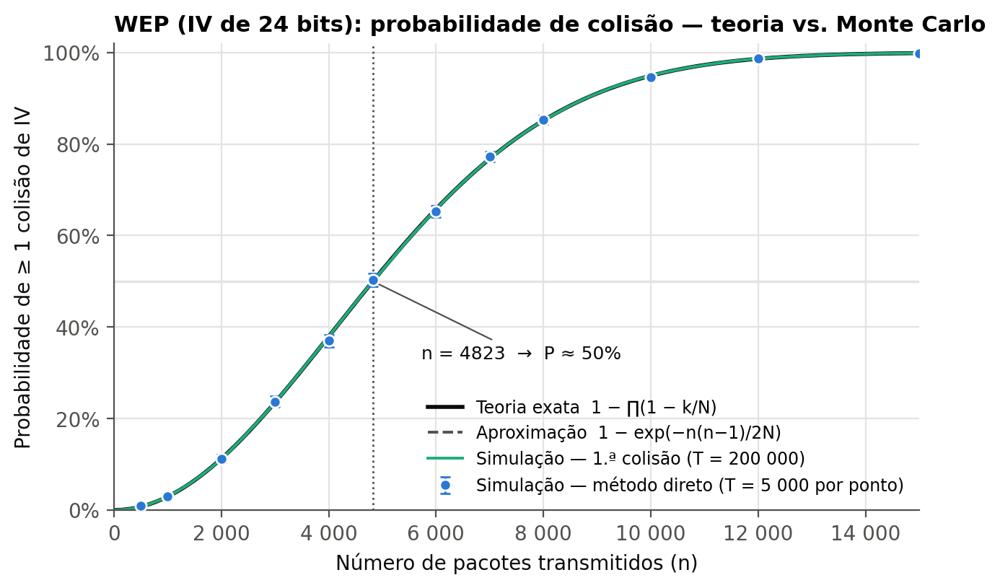
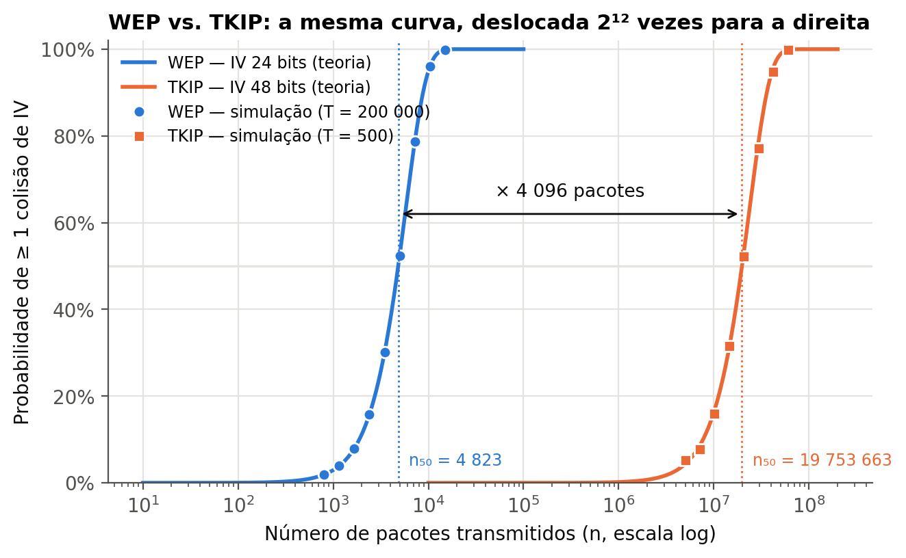

# Trabalho 6 — Simulação de Monte Carlo da probabilidade de colisão de IV no WEP

**Tecnologias de Redes de Comunicações Móveis** · Mestrado em Engenharia Informática · Claudio Baptista

Simulação por Monte Carlo da probabilidade de dois pacotes WEP reutilizarem o mesmo vetor de
inicialização (IV de 24 bits), comparação com a fórmula exata do problema do aniversário
generalizado e com o IV de 48 bits do TKIP.

## Resultados principais

| | Teoria | Simulação |
|---|---|---|
| P(colisão) no WEP com 4 823 pacotes | 50,00% | 50,01% (200 000 ensaios) |
| Pacotes para 50% de colisão com IV de 48 bits (TKIP) | 19 753 663 | mediana 20 186 196 (500 ensaios) |
| Colisões TKIP com até 15 000 pacotes | ≈ 0,006 esperadas | 0 em 60 000 ensaios |

O TKIP precisa de 4 096 vezes mais pacotes do que o WEP para a mesma probabilidade de colisão
(2¹² = √(2⁴⁸/2²⁴)), e não 2²⁴ vezes: contra colisões, a segurança de um identificador de b bits é de
apenas b/2 bits (paradoxo do aniversário).





## Entregáveis

| Ficheiro | Conteúdo |
|---|---|
| `relatorio/Relatorio_Trabalho6_MonteCarlo_WEP.pdf` | Relatório completo |
| `apresentacao/Apresentacao_Trabalho6_MonteCarlo_WEP.pptx` | Apresentação (com notas do orador) |
| `src/` | Implementação em Python |
| `figuras/` | Figuras geradas pela simulação |
| `resultados/` | Resultados numéricos (JSON, CSV) e amostras brutas (NPY) |

## Estrutura do código

| Módulo | Responsabilidade |
|---|---|
| `src/teoria.py` | Fórmula exata (em domínio logarítmico), aproximações, n para 50%, distribuição da 1.ª colisão |
| `src/montecarlo.py` | Estimador direto e estimador por primeira colisão, IC de Wilson, paralelização |
| `src/experiencias.py` | Experiências E1–E7, gravação de resultados e figuras |
| `src/graficos.py` | Figuras (matplotlib) |
| `relatorio/gerar_relatorio.py` | Gera o PDF a partir de `resultados/` e `figuras/` |

## Execução

```bash
pip install -r requirements.txt
cd src
python experiencias.py              # todas as experiências (~20 min em 8 núcleos)
python experiencias.py --rapido     # versão reduzida (~3 min)
python experiencias.py --so-figuras # regenera as figuras sem voltar a simular
cd ../relatorio
python gerar_relatorio.py           # regenera o relatório em PDF
```

Todas as experiências usam uma semente fixa e o gerador Philox, pelo que os resultados são
reprodutíveis.

## Experiências

| | Descrição |
|---|---|
| E1 | WEP, método direto (fração de ensaios com colisão para 12 valores de n) |
| E2 | WEP, método da primeira colisão (curva completa e distribuição de K) |
| E3 | TKIP (48 bits), método da primeira colisão |
| E4 | TKIP com o mesmo número de pacotes do E1 |
| E5 | Convergência do estimador (erro ∝ 1/√T) |
| E6 | Lei de escala n₅₀ ∝ √N para IVs de 16 a 48 bits |
| E7 | Validação do gerador pseudoaleatório (Philox, MT19937, PCG64) |
